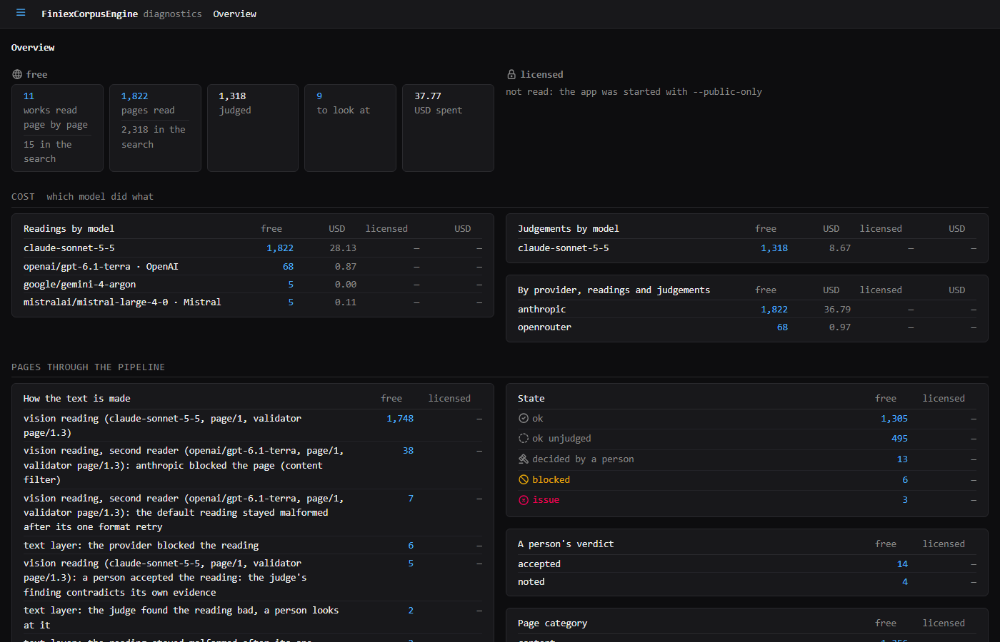
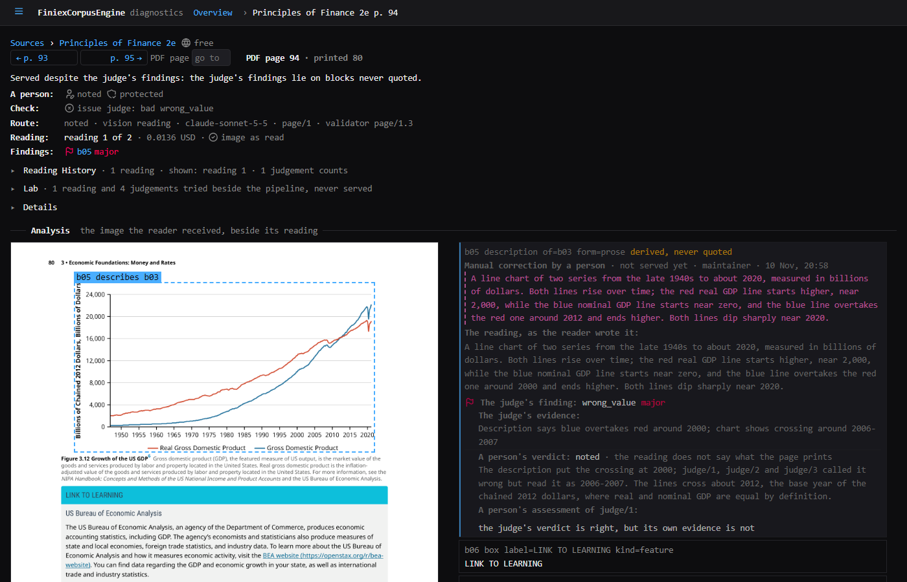
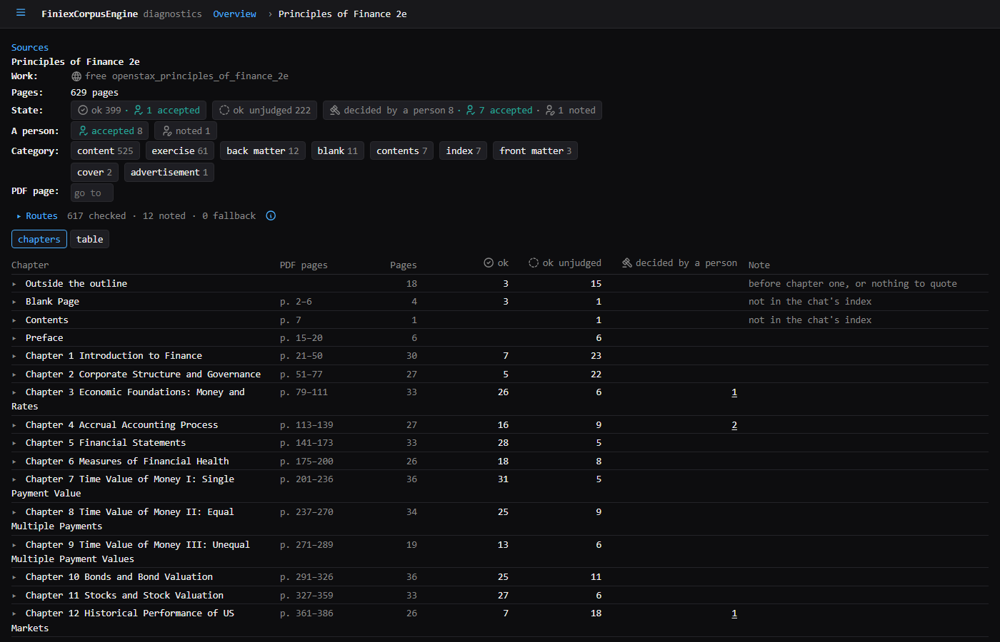
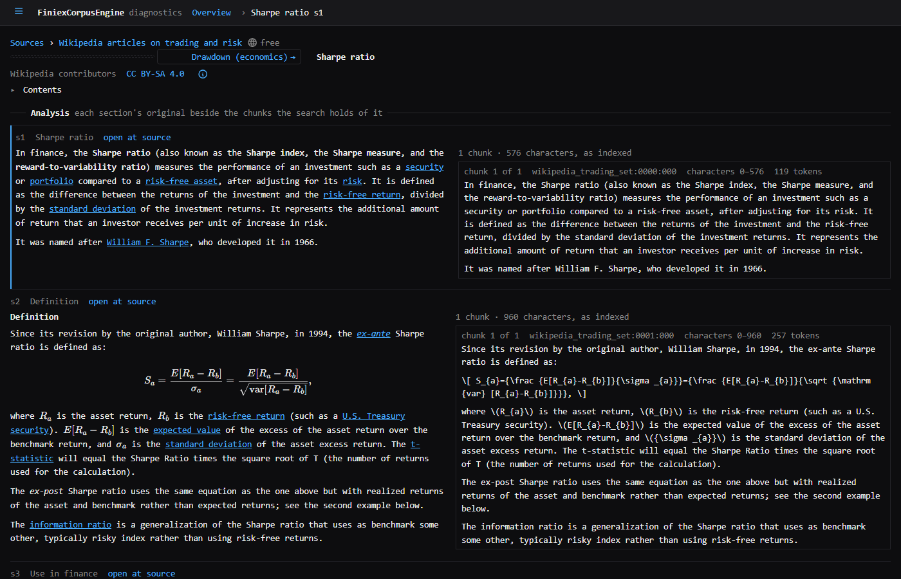
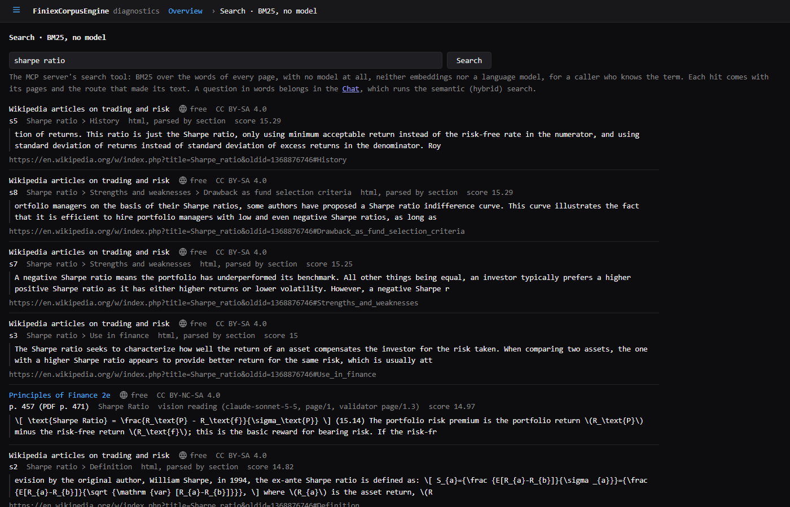
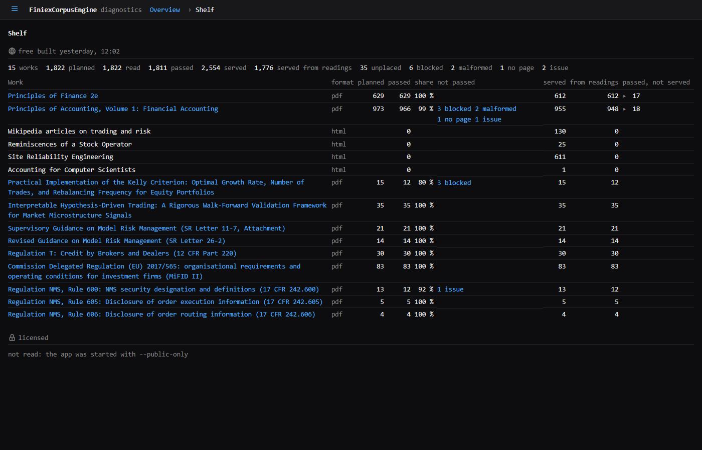
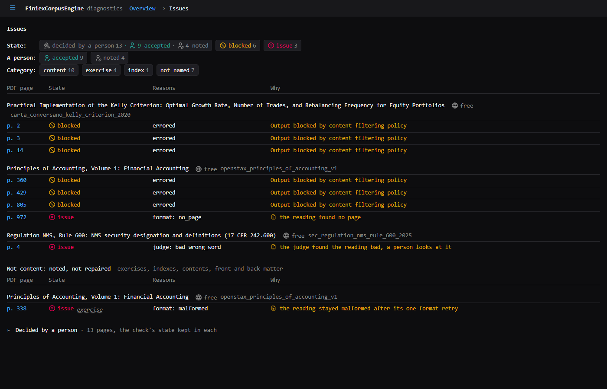
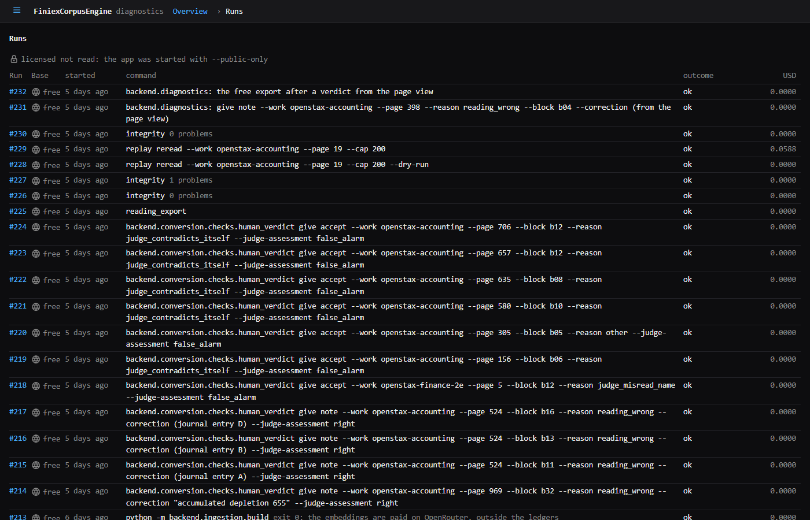
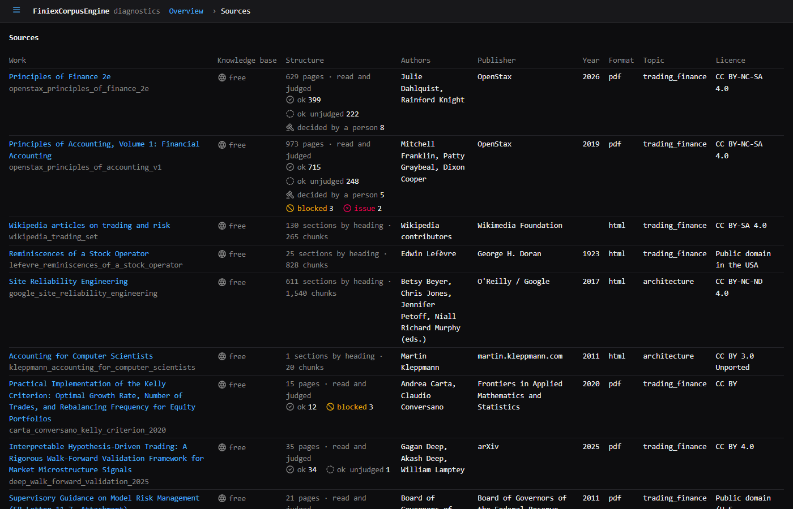

# FiniexCorpusEngine: a small Google Books for trading knowledge

**Every answer with a verbatim quote and its page, verified rather than guessed.**

This project builds a knowledge base on trading, finance, accounting and running software reliably, and answers questions
from it with exact, licensed citations. The problem it solves: a language model answers fluently even when it is wrong, and
the usual way of feeding it books, extracting the PDF's text layer, loses exactly what a technical reader needs to quote:
formulas, tables, figures and the indentation of code. So the pipeline first turns every page into a verified transcription
(a vision model reads the page image; code checks the result against the PDF's own text layer; a second model judges a
sample, everything suspicious and everything the text layer cannot confirm; a person stays the final judge), then searches
those pages and answers only with what they say, quote and page included. Where the sources hold nothing, the answer says so.

The holding is the library; **the librarian is a search server over the Model Context Protocol**. It tells what is on the
shelf and what each work is for, finds the works that hold a subject, opens a work's contents and a page, shows the page's
image to check a quote, and says "nothing found" when nothing is. A coding assistant asks it directly; the chat is its client.

One of the Finiex apps, beside the testing IDE, the viewer, the data collector and the RAG engine. It began as a Turing
College capstone (AI Engineering, reviewed on 16 November 2026), which continued the course's RAG sprint; the phase chapters
and protocols in `docs/` keep that history as it happened.

---

## How it works

```
 sources (PDF, HTML)                                                     licences verified (corpus/catalog.json)
   │
   ├─ free check per page ── text only? ─────────────────────────────►  text layer, as it is
   │        └─ formula, table, figure, code ──┐
   │                                          ▼
   │                              vision model reads the page image  ►  one Markdown page file (contract page/1)
   │                                          │
   │                 stage 1  format          │  code: the file parses against the contract
   │                 stage 2  content         │  code: words, numbers, LaTeX, code, tables against the PDF's text layer
   │                 stage 3  judge           │  a model sees image and reading: a sample + every suspect + every page
   │                                          │  with a block the text layer cannot confirm (an image of a table, a drawn formula)
   │                                          ▼
   │                       ok · not judged · issue (re-read once, told the judge's findings) · blocked (text layer kept)
   ▼
 pages ──► page BM25 ──────────────────────►  the librarian (MCP server)
       └─► chunks, embeddings ──┐               works · search_works · toc · search · open_page · page_image
                                ▼               semantic_search: router ─► vectors + BM25 on keywords ─► RRF ─► floor
                          the chat's index ────►      └─► the chat, its client: answer, verbatim quotes, page, licence
```

- **Every model answer is stored once,** under a key made from everything that was asked (page image, model, prompt,
  parameters, attempt). It is never bought twice and never overwritten; a re-run is a new, keyed attempt beside the old one.
  Everything after a reading is code, so the pipeline is deterministic by construction although it calls models.
- **Every page keeps its trace:** which route made its text, which model read it, its check state, the judge's verdict or why
  it was not judged. The readings' export (`corpus/readings/index.json` in the data) holds it for every free page.
- **The search** answers in three states: found, nothing found, or an error for a wrong argument. Every hit names its
  knowledge base, work, page (printed and PDF), section, file, licence and the route that made its text.
- **The retrieval behind the chat** (`semantic_search`): a router model decides whether to search, clarify or decline, and
  rewrites the question into a search query, a broader step-back query and keywords; vector search over both queries and BM25
  over the keywords are fused by reciprocal rank fusion; exercise sections yield their rank; below a relevance floor the
  answer is told to be careful. The generator answers only from the passages, and code checks every quote word for word.

## What it looks like

The diagnostics view (`python -m backend.diagnostics`), showing the free knowledge base. Every number in it is the
core's own; the view computes nothing.

*The screenshots show excerpts of* Principles of Finance 2e *(Julie Dahlquist, Rainford Knight; OpenStax, Rice
University; [CC BY-NC-SA 4.0](https://creativecommons.org/licenses/by-nc-sa/4.0/)) and of Wikipedia's article*
[Sharpe ratio](https://en.wikipedia.org/w/index.php?title=Sharpe_ratio&oldid=1368876746) *(Wikipedia contributors;
[CC BY-SA 4.0](https://creativecommons.org/licenses/by-sa/4.0/)), shown in this project's view beside its own readings
and checks. These images are shared under CC BY-NC-SA 4.0, not under the code's MIT licence.*

**The overview:** works and pages read, judged and still to look at; which model read and judged how many pages at what
cost; pages by route, state and a person's verdict.



**One page checked end to end** (*Principles of Finance 2e*, PDF page 94): the page image the reader received beside its
reading, the judge's finding on the chart's description, a person's correction above the reader's text, and the person's
verdict on the judge.



**A work by its own chapters,** each chapter's pages counted by check state, a person's decisions marked:



**An HTML work by section** (Wikipedia, *Sharpe ratio*): the original section with its formula beside the chunks the
search indexed from it.



**The librarian's keyword search** (BM25, no model) for "sharpe ratio": each hit with its work, section or both page
numbers, licence, route and score.



**The shelf, the issues and the runs:** every work with pages planned, passed and served, and why a page did not pass;
the pages a person should look at, one click from each; every pipeline run with its command, outcome and cost.







**The corpus:** every work with its authors, publisher, year, format, topic and licence.



## How the chat calls its tools

The chat is an agent (LangChain's `create_agent`) with eight tools, and every answer goes through the same loop:

1. **Description.** The model sees each tool's name, its docstring and its argument schema, for example `position_size`:
   "A position size by fixed fractional risk, and/or the Kelly fraction with half-Kelly", with typed arguments
   `account_size`, `risk_percent`, `entry_price`, `stop_price`, `win_probability`, `win_loss_ratio`.
2. **Tool call.** For "how much should I buy with 10,000 at 1 % risk, entry 50, stop 48?" the model does not answer: it returns a
   call, the tool's name and JSON arguments `{"account_size": 10000, "risk_percent": 1, "entry_price": 50, "stop_price": 48}`.
3. **Execution.** Our code runs the function (`trading_tools.position_size`): plain Python, no model, inputs validated; a bad
   input comes back to the model as an error message, not a crash.
4. **Result.** The result returns to the model as a tool message, and the model writes its one sentence around it; the numbers
   are explained by code, never by the model.

A knowledge question takes the same loop: the agent calls `search_knowledge_base`, which asks the librarian's
`semantic_search` over MCP for passages and lets the generator answer from them; the server's answer is shown as it came
(`return_direct`). The other tools are the librarian's own, reached through the same MCP session: `semantic_search`,
`search`, `open_page`, `page_image` and `works`. The loop is capped at 5 model calls and 4 tool calls per message (LangChain's own middlewares), and the
chat model has a 120 s timeout and no hidden retries.

## Measured so far

| step | result |
|---|---|
| format pilot, 20 pages, 14 with the publisher's own markup as gold | 112 of 112 formulas exact; Markdown blocks beat JSON on cost and validity |
| reading the free corpus: 11 PDFs, 1,822 pages | 27.49 USD in batches; 1,811 pages passed every check, 1,776 served from a checked reading |
| the provider's safeguards | 44 of the first 1,652 pages (2.7 %) blocked by the content filter, all long prose; respected, never argued with: a second reader of another company (through OpenRouter) read the free pages the provider blocked or that stayed malformed, every such page judged, and 46 of 68 now stand, each saying why |
| the judge's issues, read again | a page whose findings lie only on blocks never quoted keeps its reading; every other one was read once more, told the judge's findings, and judged again: 26 of 38 passed; the rest a person walked page by page against the image: 12 decided (accepted, or corrected beside the reading), 4 still open |
| judge calibration (pilot) | 48 of 49 planted errors caught, 0 of 8 clean pages made an issue |
| a person judged the judge: 16 free pages the active judge called bad, 14 of them right | four judge versions against the person's verdicts: 0, 10, 9 and **13** of 14 agree; only the fourth, on another model, read a chart both reader and judge had misread |
| a reader prompt built from those findings (prototype, 26 free pages, never served) | table cells exact against publisher gold 221 → **224** of 224, nothing lost; 4 of the 6 reader errors the person confirmed fixed; a chart's value stayed wrong: rules change how a model writes, not what it sees |
| choosing which pages need the vision model | free rules from the PDF's objects keep 97 % recall on the free textbooks |
| keyword search | every free work found by a probe from its own middle third; a warm query in about 10 ms |
| retrieval through the chat, 61 development questions | section recall@5 0.60, the first expected section in the top 5 for 84 %; 44 to 47 behaviours right across the last runs, the generator's variance; each change kept only where a paired comparison held |
| **held-out set**, 10 questions written before tuning, read once | **7 of 10** behaviours right; the three misses are a routing decision, a timed-out search and an answer where nothing was expected |
| **RAGAS** (judge `gpt-4.1-mini`, not the chat's model) | faithfulness **0.94** (development) and **0.97** (held-out); context precision 0.63 / 0.75, context recall 0.68 / 0.81 against the course's mark of 0.7 |
| independent code review (4 reviewers, every finding attacked by a skeptic) | 9 findings confirmed, all fixed with tests |

Gates were written before each measurement; where a check was corrected after seeing results, both numbers are kept. The
full plans, gates, reports and protocols, mistakes included, are in [docs/](docs/README.md); the evaluation report is
[phase 7](docs/phase_07_evaluation.md).

## Quick start

Python 3.13. Without Docker everything runs from files: the librarian assembles its index from them at every start, and
the vectors are read from a Chroma store on disk. With Docker, the index lives in PostgreSQL with pgvector, loads in
seconds and serves a changed page without a restart (below).

```bash
python -m venv .venv
.venv/Scripts/python.exe -m pip install -r requirements.txt   # Linux, macOS: .venv/bin/python
cp .env.example .env                                           # then fill in the keys you have

python -m backend.ingestion.acquire          # downloads the free sources into _data/corpus/raw/ (about 210 MB)
python -m backend.ingestion.build            # embeds and indexes the corpus (about 0.03 USD; OpenRouter or OpenAI, below)

python -m backend.search.search_server --public-only        # the librarian over MCP (stdio); --http 8765 on 127.0.0.1, behind a token
python -m backend.diagnostics --public-only                 # the diagnostics view on http://127.0.0.1:8001: pages, checks, shelf, chat
python -m backend.diagnostics --allow-verdicts              # the same, taking a person's verdict on a page (needs the store)
pytest                                                      # the offline suite: no test calls a paid API
```

### As a service, with the index database (Docker)

The native start above needs nothing but Python. With Docker, the librarian and the diagnostics view keep running and
start again whenever Docker starts, and the index can live in a database:

```bash
docker compose up -d --build     # librarian, view, postgres (pgvector) and pgAdmin; the repository is mounted at /app
docker compose logs -f librarian # the server's banner: bases, routes, tools, where the index and the vectors come from
docker compose down              # stop them

python -m backend.database.migrate            # the schema, numbered SQL files applied once each; --status shows them
python -m backend.search.database.index_import   # fills the database from today's index and vectors, then a gate
python -m backend.search.database.index_import --works KEY ...   # one work written again, in seconds
```

Every service listens on 127.0.0.1 alone: the librarian on port 8765 (`/mcp`, behind the bearer token in `.env`), the
view on 8021, PostgreSQL on 5434 (its password `CORPUS_DB_PASSWORD` in `.env`), pgAdmin on 5051 for development. Another
container on the same machine reaches the librarian as `host.docker.internal:8765/mcp`. The data folders and `.env` stay
on the host and are read through the mount.

**The switch.** `database.librarian_reads` in `configs/app_config.json` is `memory` by default: the index is assembled
from files at every start (one to two minutes). Set to `database`, in the tracked file or in a git-ignored
`configs/app_config.local.json` laid over it, the librarian loads works and pages from the database in about two
seconds, ranks with the same BM25 in SQL, reads the semantic search's vectors from pgvector, and serves a page an import
or a person's verdict wrote on its next call. A database that is down, unconfigured or empty never stops it: it says why
and assembles from files. `--public-only` always reads files. Chroma still writes the vectors; the import copies them.
Each half was gated before it was switched on: every coverage probe ranked the same and every tool answered the same; on
104 questions the vector search found at least as much of the exact top ten as Chroma did
([phase 3](docs/phase_03_search_server.md)).

### The data

This repository holds the code, the docs and the tests. The data lives apart, in `_data/` (git-ignored), with the
repository's own layout. Where each folder lies is set in `configs/app_config.json` (`paths`), and the code reaches it
through one module, `backend.configuration.data_paths`:

| in `_data/` | what | on a fresh clone |
|---|---|---|
| `corpus/raw/` | the free sources, unmodified, with their checksum manifest and `LICENSES.md`, the attribution each licence asks for | `acquire` downloads them, each from the place and under the licence `corpus/catalog.json` names |
| `corpus/readings/` | the verified page readings of the free PDFs and their trace | not public; without them the search serves each PDF page from its text layer, and the views show no readings |
| `evaluation/results/` | the record of every measurement in `docs/` | not public; the evaluation commands write new ones |

The tests that need data say so with a marker (`corpus`, `readings`) and skip where it is missing, so a fresh clone runs the
suite green. Reading pages again needs an Anthropic key and spends money; every command that spends shows its estimate first
and stops at a spending cap.

**The embeddings** come from OpenAI's `text-embedding-3-small`, directly from OpenAI (`CORPUS_OPENAI_API_KEY`, a project
key allowed that one model) or through OpenRouter (`OPENROUTER_API_KEY`), as `embeddings.provider` in
`configs/app_config.json` says (OpenAI since 23 Nov 2026). Both routes return the same vectors (cosine 1.0, measured), so
the index stays when the route changes; it records its model and refuses to open with another.

**The chat's models** (the agent, the router and the generator) each name their provider in the same file: Anthropic's
`claude-haiku-5-5` since 23 Nov 2026 (`ANTHROPIC_API_KEY`), OpenRouter's models before it (`OPENROUTER_API_KEY`). A
running server takes a change when it restarts.

**The RAGAS report** runs in an environment of its own, since RAGAS 0.4.3 needs older `openai` and `langchain` packages than
the app:

```bash
python -m venv .venv-eval
.venv-eval/Scripts/python.exe -m pip install -r requirements-eval.txt
.venv-eval/Scripts/python.exe -m backend.evaluation.ragas_report _data/evaluation/results/answers_<label>.json   # a record of answer_eval
```

## Repository

| path | what |
|---|---|
| `src/backend/conversion/` | one folder per concern: `contract/` (the page file the reader writes), `reading/` (rendering, the batch runner, the rollout, the replay of one page), `checks/` (stages 1 and 2, the check flow, a person's verdict), `judge/`, `measurement/` (the mini pilot, publisher gold, a reader prototype), `store/` (readings, the pipeline database, the export); the prompts and their versions beside them |
| `src/backend/search/` | the page BM25, the librarian (MCP server) and its retrieval chain, the shelf; `database/`, the index in PostgreSQL: import, gate, BM25 in SQL, the pgvector store |
| `src/backend/database/` | the schema's migrations and their runner |
| `src/backend/ingestion/`, `chat/`, `evaluation/` | loading, chunking, embedding; the agent, a client of the server; the evaluations and the RAGAS report |
| `src/backend/diagnostics/`, `src/frontend/diagnostics/` | the diagnostics view: a read-only API (the chat route aside, which spends and writes the turn log; and, only when started with `--allow-verdicts`, a person's verdict on a page, appended and exported in the background) and its Vue interface, built and committed |
| `src/backend/configuration/`, `configs/` | the configuration, read once and checked against its typed model; `data_paths`, where the data lives (`_data/`, see *The data*) |
| `corpus/catalog.json` | every free source: its licence, where it is fetched from, its files |
| `evaluation/` | the 61 development questions (60 measured; q31 added after the runs), the held-out set and its reading ledger |
| `docs/` | the roadmap and one chapter per phase: plan, gates, report; the protocols |
| `tests/` | about 1,660 offline tests; `tests/contracts/` holds the rules about the repository itself; tests marked `database` use a scratch database of their own and skip without one |

## Ethical considerations

- **Licences.** Only freely licensed or public-domain sources are used, each licence read at its source before the work
  entered (`corpus/catalog.json`; the attribution in `LICENSES.md` beside the downloaded sources). The page readings are
  adaptations and carry their works' licences and attribution in their own README; a work under a NoDerivatives licence is
  never transformed, only quoted. A quote is always the original wording; a rewording is never shown as one. The code is
  MIT-licensed ([LICENSE](LICENSE)); the material it works on keeps its own licences. [NOTICE.md](NOTICE.md) lists every
  free work with its authors, source and licence, what the project does with it, and which works may not be used
  commercially; it is written from the catalog, so a new work appears there with it.
- **The provider's safeguards are respected.** The content filter blocked 2.7 % of freely licensed pages, and the model itself
  declined a few. No page is split, paraphrased or sent through the same model by another door to get past them; such a page
  keeps its own text layer, and its record says why. The same pipeline can serve a second, private knowledge base that stays
  on its owner's machine; nothing of it is committed, a start switch (`--public-only`) leaves it unread, and every number
  above uses the free corpus only. Contract tests hold that line on the owner's machine before every push: no tracked file
  names a private work, and none shares a passage of its text (`tests/contracts/test_no_licensed_text_in_tracked_files.py`).
- **No answer from the model's own memory.** The chat answers from retrieved pages only; where nothing is found it says so.
  Figure descriptions written by the reader are marked as derived and never quoted. The held-out run shows where this still
  fails: one near miss above the relevance floor was answered.
- **Measured trust, not assumed trust.** A model judges another model's readings, so its own noise is measured on planted
  errors and clean pages. Reader and judge are the same model family, a shared blind spot the planted errors cannot measure;
  the human stays the final judge of the issues. RAGAS is judged by a model too, and its numbers carry that judge's noise.
- **Privacy, keys and the server.** API keys and the database password live in a git-ignored `.env` and never reach a
  client; a foreign image (PostgreSQL, pgAdmin) is handed only the variables it needs, never the whole file. The librarian
  and the database bind to 127.0.0.1; the librarian refuses every request without its token, offers read-only tools, bounds every search (1 to 50 hits) and refuses
  an unknown corpus or work before any work. Its call log keeps the queries, which client asked, and the pages that answered,
  never a page's text, and stays out of the repository. The course's MCP security points, each with its evidence and what is
  left open (no rate limit, prompt injection mitigated but not measured), are in [docs/mcp_security.md](docs/mcp_security.md).
- **Bias.** The corpus is narrow: English only, two US textbooks (US GAAP), US supervisory guidance and regulation, the EU's and
  the SEC's rules on cost and execution reporting, a handful of papers, Wikipedia articles and one book on site reliability.
  Answers inherit that scope; the evaluation questions measure it rather than hide it. A rule binds one jurisdiction and one
  kind of market (the SEC's rules: US equities, order-driven): each quote names its rule, and each work's description says
  whom it binds, so an answer from a US rule is not mistaken for an EU one.
- **Cost.** Every paid run is estimated before it starts, guarded by a spending cap, and logged with its actual cost.

## Status and what comes next

Phases 1, 2, 3, 5, 6 and 7 of the [roadmap](docs/roadmap.md) are done: the reader's format, the corpus read and judged, the
search server, verified pages in the chat's index with a pipeline that heals a damaged reading, retrieval measured through the
chat, and the evaluation report. Next, each from a case that asked for it:

- **Code as a source, with the reports of real runs** (a backtesting engine's own code and the reports of a simulated and a live
  run), so a question on how a fee is shown in a report gets a real example instead of an analogy.
- **Knowledge bases as switchable entities:** one registry and a switch per base, where today one switch gives out the free
  base alone.
- **The decision whether to answer:** the router's plan, the relevance floor and a retry for a search that failed in passing,
  the three causes of the held-out misses, each measured before it changes.
- **Scans and a local model, the EPUB route, tracing,** and tickets from the librarian's consumers that trigger the re-reading
  of one page.
